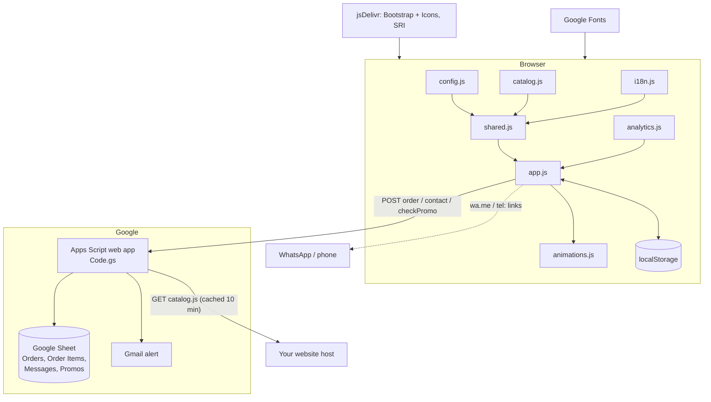
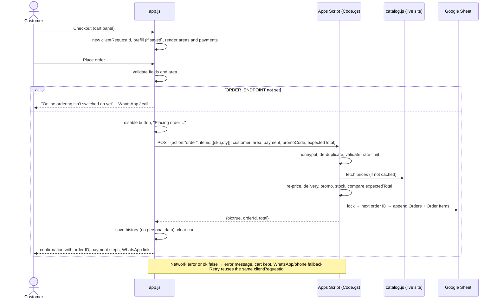

# ARCHITECTURE — Cha Bazaar

> Status legend: **IMPLEMENTED** · **PROPOSED** · **TBD** (see [PRD.md](PRD.md)).
> Related: [DATABASE.md](DATABASE.md) · [API.md](API.md) · [INTEGRATIONS.md](INTEGRATIONS.md) · [AUTH_SECURITY.md](AUTH_SECURITY.md) · [apps-script/README.md](apps-script/README.md)

## 1. Technology stack (IMPLEMENTED)

| Layer | Technology | Notes |
|---|---|---|
| Pages | Static HTML: `index.html` + 4 policy pages | No build step, no framework |
| Styling | CSS custom properties (`styles.css`, `animations.css`) + Bootstrap 5.3.3 | Bootstrap and Icons 1.11.3 from jsDelivr with **SRI hashes** |
| Fonts | Big Shoulders Stencil, Hind Siliguri (Google Fonts) | Hind Siliguri renders Bangla |
| Front-end logic | Vanilla JavaScript (ES2020, classic scripts) | `config.js`, `catalog.js`, `i18n.js`, `shared.js`, `analytics.js`, `app.js`, `store.js`, `animations.js` |
| Order server | **Google Apps Script** web app (V8), bound to a Google Sheet | `apps-script/Code.gs`, `appsscript.json` |
| Data | `catalog.js`, Google Sheet, browser `localStorage` | See DATABASE.md |
| Hosting | Any static host; GitHub Pages expected (`https://sanjidmolik.github.io/Tea_shop/`) | Pages status TBD |
| Dev tooling | Node + Playwright (tests, social image), Python + Pillow (images) | `package.json` has **dev dependencies only** |

**Not present:** a bundler, a framework, runtime npm packages, a payment gateway, customer accounts, a server you have to run yourself.

## 2. Folder structure

```
Tea_shop/
├── index.html                 shop (nav, hero, teas, samplers, trust/reviews, about, contact,
│                              cart, quick view, checkout, confirmation, WhatsApp button)
├── delivery.html returns.html privacy.html terms.html   policy pages, English + Bangla
├── config.js                  business settings: endpoint, phone, WhatsApp, Facebook, bKash/Nagad, analytics
├── catalog.js                 products, variants, stock, delivery zones, reviews (strict JSON)
├── i18n.js                    English/Bangla strings, t(), applyI18n()
├── shared.js                  shared helpers (contact links, delivery fee, language, setup notice)
├── analytics.js               optional Plausible / GA4 (consent) → chaTrack()
├── app.js                     cart, product cards, quick view, checkout, contact
├── store.js                   menus, home sections, shop listing + filters, product pages, URL routing
├── animations.js / .css       optional motion layer (+ pause control)
├── styles.css                 design tokens + components
├── apps-script/
│   ├── Code.gs                order server
│   ├── appsscript.json        manifest: Dhaka time zone, minimal scopes, web-app settings
│   └── README.md              deployment guide
├── tests/
│   ├── check.js               static checks
│   ├── server.test.js         25 tests of Code.gs
│   ├── e2e.test.js            browser tests (Playwright)
│   ├── gas-mock.js            runs Code.gs on simulated Google services
│   └── mock-server.js         local site + /exec for development and tests
├── tools/
│   ├── optimize-images.py     JPEG → WebP (card + large)
│   ├── og-image.html          social image template
│   └── render-og-image.js     renders og-image.jpg
├── Tea/                       original photos (fallbacks); Tea/webp/ optimised copies
├── og-image.jpg  robots.txt  sitemap.xml  package.json
└── *.md                       documentation
```

## 3. Components



**Script order** (all classic scripts at the end of `<body>`): Bootstrap bundle → `config.js` → `catalog.js` → `i18n.js` → `shared.js` → `analytics.js` → `app.js` → `store.js` → `animations.js`.

**Views (v3):** `index.html` holds three views, switched by `store.js` without reloading (History API): home (`index.html`), shop listing (`?shop=<department|category>&origin=…&caffeine=…&flavour=…&price=…&q=…&sort=…`) and product page (`?product=<slug>`). `#tea/<slug>` opens the quick view over any view. Each view sets its own title, description and canonical URL. Same-page links are intercepted; other links load normally. Policy pages load only `config.js`, `catalog.js`, `i18n.js` and `shared.js`.

### Design decisions

| Decision | Why |
|---|---|
| One catalogue file read by both the browser and the server | Prices, stock and delivery fees can't drift; the server never trusts browser totals |
| Strict-JSON `catalog.js` instead of a `.json` fetch | Works when opening `index.html` as a file, needs no extra request, and the server can still parse it |
| Apps Script + Sheets | Free, no hosting, the owner already knows spreadsheets, Google handles HTTPS and login |
| `text/plain` POST | Avoids a CORS preflight that Apps Script can't answer |
| `clientRequestId` per checkout attempt | Repeat clicks and retries after a timeout can't create duplicate orders |
| Settings and catalogue separate from UI code | The owner edits business data without touching logic |
| Unset settings hide their UI | No `YOUR_…` placeholders are ever shown to customers |
| Motion in its own files | The shop works fully without it |
| English text stays in the HTML; Bangla in `i18n.js` | Search engines and no-JS visitors get complete English pages |

## 4. Data flow: placing an order (IMPLEMENTED)



## 5. Configuration

| File | Key | Purpose |
|---|---|---|
| `config.js` | `SITE_URL` | Share links, structured data |
| | `ORDER_ENDPOINT` | Apps Script `/exec` URL |
| | `BUSINESS_PHONE`, `WHATSAPP_NUMBER`, `FACEBOOK_URL`, `BUSINESS_EMAIL`, `BUSINESS_ADDRESS`, `OPENING_HOURS` | Contact |
| | `BKASH_NUMBER`, `BKASH_ACCOUNT_TYPE`, `NAGAD_NUMBER`, `NAGAD_ACCOUNT_TYPE` | Manual payment steps |
| | `RETURN_WINDOW_DAYS` | Policy text |
| | `ANALYTICS` | `provider`, `plausibleDomain`, `ga4MeasurementId` |
| | `SHOW_SAMPLE_REVIEWS_IN_DEV` | Labelled sample reviews on localhost only |
| `catalog.js` | `delivery.zones`, `lowStockThreshold`, products | Business data |
| Script properties | `CATALOG_URL`, `OWNER_EMAIL` | Server settings |
| `app.js` constants | `MAX_QTY` (50), `REQUEST_TIMEOUT_MS` (20000), storage keys | Technical |

There are **no environment variables** and no secrets in the website. Values starting with `YOUR_` count as unset.

## 6. Limitations

1. Stock is a number in `catalog.js`; it is not reduced automatically when orders arrive.
2. Price changes reach the server within about 10 minutes of publishing (catalogue cache). Orders in that window get `total_changed` and must be re-submitted. This is safe, but the customer sees a message.
3. Apps Script quotas apply (daily e-mails, executions). They're fine for a small shop; check Google's quota page before big campaigns.
4. Product descriptions, tasting notes and ingredients are English only.
5. One product image (Premium Estate Blend) is hotlinked from Unsplash.
6. No Content-Security-Policy yet (GitHub Pages can't set headers; a `<meta>` CSP is proposed).
7. Hash links (`#tea/…`) aren't separate pages for search engines; products are described with JSON-LD on the home page.

## 7. Future (PROPOSED)

| Step | Needs |
|---|---|
| Live stock in the Sheet, decremented per order | Small change to `Code.gs` and a read endpoint |
| Online bKash/Nagad payment | Own server, merchant accounts, owner approval (P-22) |
