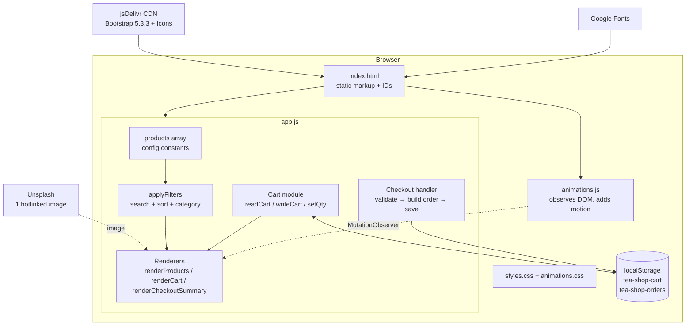
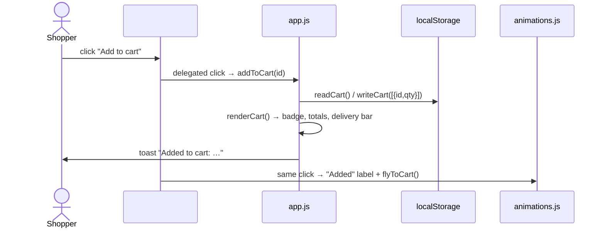
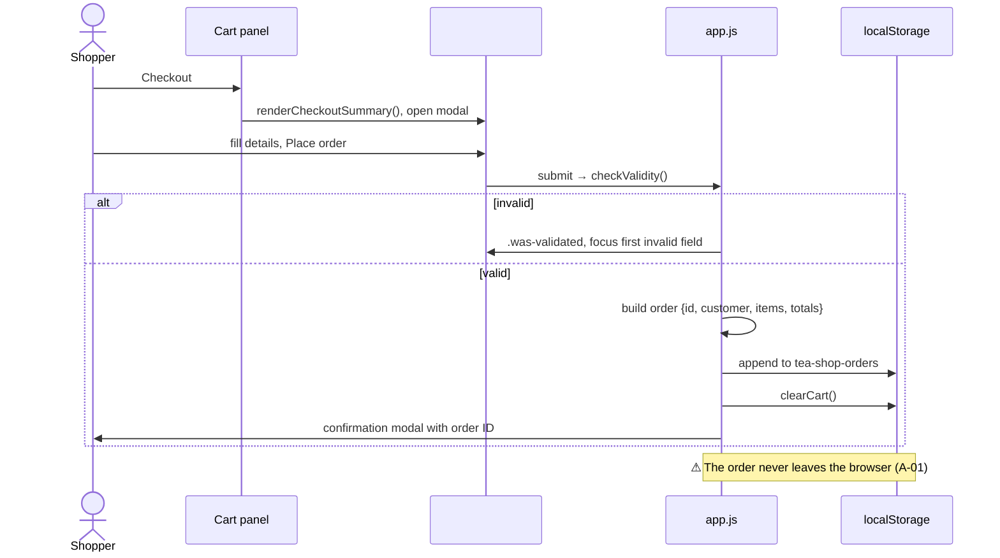
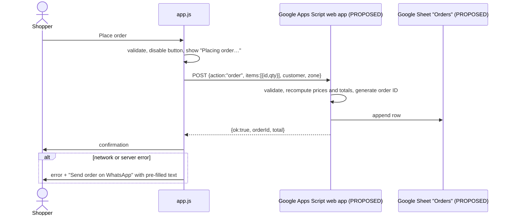
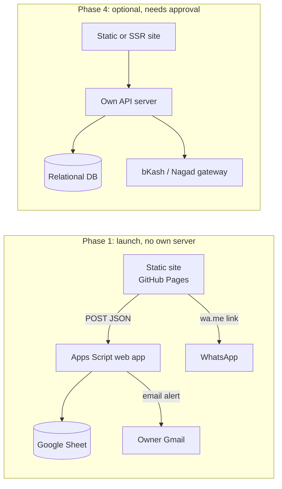

# ARCHITECTURE — Cha Bazaar

> Status legend: **IMPLEMENTED** · **PROPOSED** · **TBD** (see [PRD.md](PRD.md)).
> Related: [DATABASE.md](DATABASE.md) · [API.md](API.md) · [INTEGRATIONS.md](INTEGRATIONS.md) · [AUTH_SECURITY.md](AUTH_SECURITY.md)

## 1. Technology stack (IMPLEMENTED, verified)

| Layer | Technology | Version | Loaded from |
|---|---|---|---|
| Markup | HTML5, single page | — | `index.html` |
| Styling | CSS3 with custom properties | — | `styles.css`, `animations.css` |
| UI framework | Bootstrap (CSS and JS bundle with Popper) | 5.3.3 | `cdn.jsdelivr.net` |
| Icons | Bootstrap Icons (web font) | 1.11.3 | `cdn.jsdelivr.net` |
| Fonts | Big Shoulders Stencil, Hind Siliguri | Google Fonts | `fonts.googleapis.com` |
| Logic | Vanilla JavaScript (ES2020: `?.`, `??`; classic scripts, not modules) | — | `app.js`, `animations.js` |
| Persistence | Browser `localStorage` | — | See DATABASE.md |
| Browser APIs used | `localStorage`, `storage` event, `IntersectionObserver`, `MutationObserver`, Web Animations API, `matchMedia`, Constraint Validation API | — | — |

**Not present:** `package.json`, Node dependencies, bundler or build step, framework (React/Vue), back end, database server, authentication, payment gateway, environment variables, automated tests, CI.

Hosting: static files. Whether GitHub Pages is enabled for `sanjidmolik/tea_shop` is **TBD** (PRD Q-9).

## 2. Folder structure (IMPLEMENTED)

```
Tea_shop/
├── index.html          # The whole page: nav, hero, shop, about, contact, cart, checkout, confirmation, toast
├── styles.css          # Design tokens (:root) and all component styles
├── animations.css      # Motion styles, only under prefers-reduced-motion: no-preference
├── app.js              # Catalogue data, cart, filters, checkout, contact form (core logic)
├── animations.js       # Motion layer; loaded after app.js; optional
├── Tea/                # Product images (7 JPEGs, ~776 KB total)
│   ├── Assam_Tea.jpg
│   ├── Green-Tea-Leaves-2.jpg
│   ├── Loose_Jasmine_Tea_Leaves.jpg
│   ├── MIX_tea.jpg
│   ├── Masala_tea.jpg
│   ├── calming-herbal-tea-blend-chamomile-600nw-2568834187.jpg
│   └── darjeeling.jpg
└── *.md                # Project documentation (this set of 15 files)
```

**Important:** file names are case-sensitive on GitHub Pages and Linux. The first build had a broken `Assam_tea.jpg` reference for exactly this reason.

## 3. Application architecture



### Script load order (matters)

1. `bootstrap.bundle.min.js`: `app.js` calls `bootstrap.Toast`, `bootstrap.Offcanvas` and `bootstrap.Modal` at load time, so Bootstrap must load first.
2. `app.js`: renders the catalogue and cart immediately.
3. `animations.js`: wraps an IIFE around the already-rendered DOM. It is safe to remove; the shop works without it.

### Key design decisions (IMPLEMENTED)

| Decision | Reason |
|---|---|
| The cart stores only `{id, qty}` | Price and name changes in `products` apply automatically; stale IDs are dropped |
| All HTML from data goes through `escapeHtml()` | Prevents XSS if product data ever comes from outside the code |
| Event delegation on `#product-grid` and `#cart-items` | The grid is re-rendered on every filter change |
| Animation lives in separate files | It can be switched off by deleting two lines; core logic stays simple |
| No build step | Anyone can edit and deploy by uploading files |

## 4. Data flow

### 4.1 Add to cart (IMPLEMENTED)



### 4.2 Checkout (IMPLEMENTED: local only)



### 4.3 Checkout (PROPOSED, P-01)



Endpoint contract: [API.md](API.md). Sheet layout: [DATABASE.md](DATABASE.md).

## 5. Configuration and environment variables

**IMPLEMENTED:** there are no environment variables (no build step to inject them). Configuration is a set of constants at the top of `app.js`:

| Constant | Value | Purpose |
|---|---|---|
| `CURRENCY` | `"৳"` | Price prefix |
| `DELIVERY_FEE` | `60` | Flat delivery fee in taka |
| `FREE_DELIVERY_THRESHOLD` | `1500` | Free delivery from this subtotal |
| `FALLBACK_IMAGE` | `"Tea/MIX_tea.jpg"` | Replaces broken images |
| `CART_KEY` | `"tea-shop-cart"` | `localStorage` key |
| `ORDERS_KEY` | `"tea-shop-orders"` | `localStorage` key |

**PROPOSED** additions (still public constants, not secrets):

| Name | Example | For |
|---|---|---|
| `ORDER_ENDPOINT` | `https://script.google.com/macros/s/<DEPLOYMENT_ID>/exec` (TBD) | P-01, P-13 |
| `WHATSAPP_NUMBER` | `8801XXXXXXXXX` (TBD) | P-02 |
| `DELIVERY_ZONES` | `{ inside_dhaka: { fee: TBD }, outside_dhaka: { fee: TBD } }` | P-03 |

⚠ Anything in front-end code is public. Secrets (Apps Script owner credentials, bKash/Nagad API keys) must **never** be placed in these files. See [AUTH_SECURITY.md](AUTH_SECURITY.md).

## 6. Limitations (current)

1. No server, so orders and contact messages aren't delivered (A-01, A-13).
2. Product data is hard-coded; editing prices needs a code change and redeploy.
3. Prices and totals are calculated in the browser. That's fine while nothing is charged, but a server must recalculate them once orders are sent (FR-22).
4. The site depends on three third-party hosts (jsDelivr, Google Fonts, Unsplash). If jsDelivr is blocked, `bootstrap` is undefined and `app.js` stops at the toast setup (see DEBUGGING.md).
5. No Subresource Integrity (SRI) hashes on CDN files (see AUTH_SECURITY.md, P-24).
6. Personal data from past orders stays in the customer's browser storage indefinitely.

## 7. Target architecture (PROPOSED, phased)



Changing to Phase 4 changes the stack and **requires explicit owner approval** (see [AGENTS.md](AGENTS.md)).
