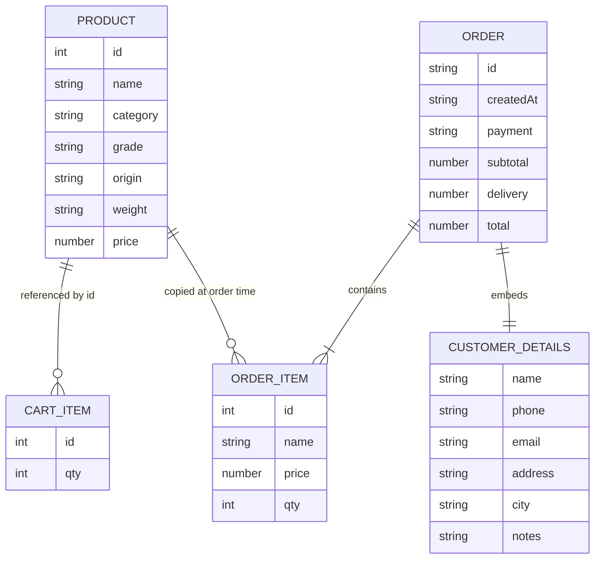
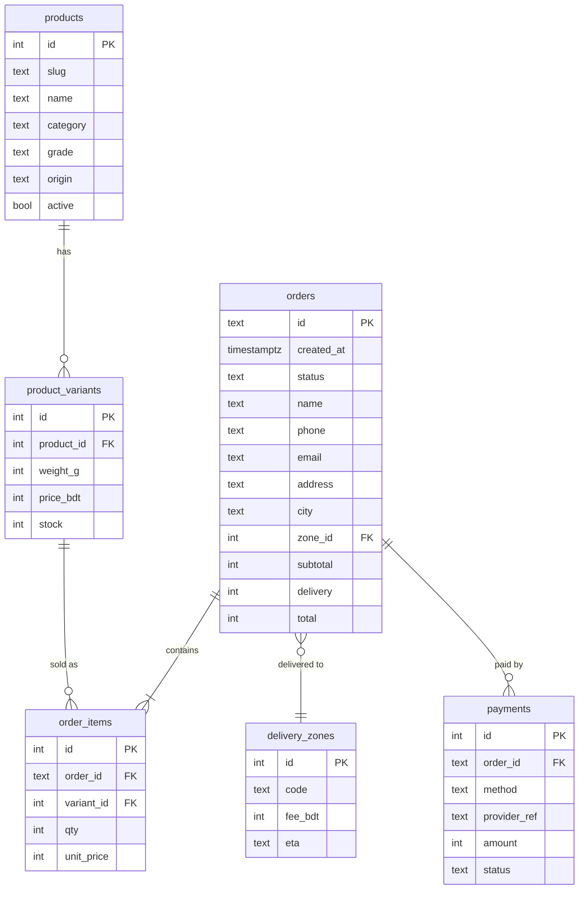

# DATABASE — Cha Bazaar Data Structures

> Status legend: **IMPLEMENTED** · **PROPOSED** · **TBD** (see [PRD.md](PRD.md)).
> Related: [ARCHITECTURE.md](ARCHITECTURE.md) · [API.md](API.md) · [AUTH_SECURITY.md](AUTH_SECURITY.md)

**Cha Bazaar has no database server.** Every implemented structure below lives either in JavaScript memory or in the visitor's browser (`localStorage`). Each visitor has their own separate copy, and the shop owner can't see it.

## 1. Implemented structures

### 1.1 Product catalogue: in-memory array (IMPLEMENTED)

Defined as `const products` in `app.js` (lines 11–38). It's read-only at runtime; changing it needs a code edit.

| Field | Type | Example | Notes |
|---|---|---|---|
| `id` | integer | `1` | Unique; referenced by the cart |
| `name` | string | `"Darjeeling First Flush"` | |
| `category` | string | `"Black"` | One of `Black`, `Spiced`, `Green`, `Herbal`; drives the filter tabs |
| `grade` | string | `"FTGFOP1"` | Tea grade code shown in amber stencil |
| `origin` | string | `"Darjeeling, India"` | |
| `weight` | string | `"100g"` | Display only; not parsed (P-05 proposes a numeric field) |
| `price` | number (taka) | `650` | Price per pack |
| `brew.temp` | number (°C) | `85` | |
| `brew.mins` | number | `3` | |
| `description` | string | | One or two sentences |
| `image` | string (URL or path) | `"Tea/darjeeling.jpg"` | Product 6 uses an external Unsplash URL |

Current rows (prices, grades and origins are **TBD until the owner confirms them**, PRD Q-6):

| id | name | category | grade | weight | price ৳ |
|---|---|---|---|---|---|
| 1 | Darjeeling First Flush | Black | FTGFOP1 | 100g | 650 |
| 2 | Assam Breakfast Blend | Black | BOP | 200g | 380 |
| 3 | Masala Chai | Spiced | CTC | 200g | 420 |
| 4 | Green Tea | Green | Leaf | 100g | 450 |
| 5 | Jasmine Green Tea | Green | Leaf | 100g | 520 |
| 6 | Premium Estate Blend | Black | OP | 250g | 950 |
| 7 | Chamomile Calm | Herbal | Whole flower | 50g | 480 |
| 8 | Everyday Mixed Tea | Black | CTC | 200g | 350 |

### 1.2 Cart: `localStorage["tea-shop-cart"]` (IMPLEMENTED)

JSON array of line items. Only the ID and quantity are stored; details are joined from `products` when read.

```json
[
  { "id": 1, "qty": 1 },
  { "id": 3, "qty": 2 }
]
```

| Field | Type | Rules (enforced in `readCart()`) |
|---|---|---|
| `id` | integer | Must exist in `products`, otherwise the row is dropped |
| `qty` | integer | Must be an integer > 0, otherwise the row is dropped |

- Written by `writeCart()` on every change; read on every render.
- Corrupt JSON or blocked storage returns `[]` (wrapped in try/catch).
- Changes made in another tab arrive through the `storage` event and trigger a re-render.

### 1.3 Orders: `localStorage["tea-shop-orders"]` (IMPLEMENTED, local only)

JSON array; each order is appended by the checkout submit handler. ⚠ It contains personal data and **is never sent to the owner** (A-01).

```json
[
  {
    "id": "CB-MW6UYNR8U2",
    "createdAt": "2026-11-07T20:28:41.123Z",
    "customer": {
      "name": "Rahim Uddin",
      "phone": "01712345678",
      "email": "",
      "address": "House 12, Road 5, Dhanmondi",
      "city": "Dhaka",
      "notes": "Call when you reach the gate"
    },
    "payment": "Cash on delivery",
    "items": [
      { "id": 2, "name": "Assam Breakfast Blend", "price": 380, "qty": 2 }
    ],
    "subtotal": 760,
    "delivery": 60,
    "total": 820
  }
]
```

| Field | Type | Notes |
|---|---|---|
| `id` | string | `CB-` + base-36 timestamp + 2 random base-36 characters. Unique per browser; global uniqueness is **not guaranteed** |
| `createdAt` | ISO 8601 string | Customer's clock |
| `customer.*` | strings | Trimmed; `phone` has spaces and dashes removed |
| `payment` | string | `"Cash on delivery"` or `"Mobile banking"` |
| `items[]` | array | Name and price copied at order time |
| `subtotal`, `delivery`, `total` | numbers (taka) | Calculated in the browser |

### 1.4 Other browser state (IMPLEMENTED, not persisted)

| State | Where | Notes |
|---|---|---|
| `activeCategory` | `app.js` variable | Resets to "All" on reload |
| Search text, sort option | DOM inputs | Reset on reload |
| Contact-form messages | Not stored at all | Discarded after the toast (A-13) |

## 2. Entity relationships (current)



## 3. Proposed structures

### 3.1 Google Sheet order store (PROPOSED, P-01 / P-13)

Recommended for Phase 1 because it needs no server and the owner can manage orders in a spreadsheet. Sheet ID and owner account: **TBD** (PRD Q-1).

**Tab `Orders`**: one row per order.

| Column | Type | Example | Source |
|---|---|---|---|
| A `order_id` | text | `CB-20261107-0042` | Generated **server-side** (format TBD) |
| B `created_at` | datetime (Asia/Dhaka) | `2026-11-07 20:28` | Server clock |
| C `status` | text | `new` | `new` → `confirmed` → `shipped` → `delivered` / `cancelled` (owner edits) |
| D `name` | text | | Customer |
| E `phone` | text | `01712345678` | Customer; validated server-side |
| F `email` | text | | Optional |
| G `address` | text | | |
| H `city` | text | | |
| I `zone` | text | `inside_dhaka` | P-03 |
| J `payment` | text | `cash` / `bkash` / `nagad` | P-06 |
| K `items` | text | `2×Assam Breakfast Blend (200g); 1×Masala Chai (200g)` | Human-readable summary |
| L `items_json` | text | `[{"id":2,"qty":2},{"id":3,"qty":1}]` | Machine-readable |
| M `subtotal` | number | `1180` | **Recalculated server-side** |
| N `delivery` | number | `60` | Server-side, from the zone |
| O `total` | number | `1240` | Server-side |
| P `notes` | text | | Customer note |
| Q `source` | text | `web` | For future channels |
| R `user_agent` | text | | Optional, for debugging |

**Tab `Products`** (PROPOSED, optional): a server-side price list the Apps Script reads to recalculate totals. Columns: `id`, `name`, `weight_g`, `price`, `active`, `stock` (stock for P-15). Until this exists, the price list is duplicated in Apps Script code. Keeping both lists in sync is a manual step; see PLAN.md.

**Tab `Messages`** (PROPOSED, P-13): `received_at`, `name`, `email`, `message`, `status`.

### 3.2 Changes to browser storage (PROPOSED)

| Change | Feature | Reason |
|---|---|---|
| Stop writing full customer details to `tea-shop-orders` once P-01 works; keep only `{id, createdAt, total}` | P-01 | Privacy (see AUTH_SECURITY.md) |
| New key `tea-shop-customer` holding name, phone, address and city, **only with an opt-in checkbox** | P-18 | Prefill the next checkout |
| Add `weight_g` (number) to products | P-05 | Calculate price per 100g |
| Add `variants: [{ weight_g, price }]` to products | P-05 | Multiple pack sizes; the cart key becomes `{ id, variant, qty }` |
| Add `slug` to products | P-07 | Shareable `#tea/<slug>` links |
| Add `stock` to products | P-15 | Stock badges |

Any cart-format change **must** migrate existing carts or safely drop invalid rows (`readCart()` already drops unknown IDs).

### 3.3 Relational database (PROPOSED, Phase 4, needs approval)

Only needed if the shop moves to its own server (see ARCHITECTURE.md §7). Draft schema; everything is **TBD**:



## 4. Data retention and privacy

| Data | Where | Retention | Status |
|---|---|---|---|
| Cart | Customer browser | Until emptied or storage cleared | IMPLEMENTED |
| Past orders with personal data | Customer browser | Indefinite ⚠ | IMPLEMENTED; to be reduced (§3.2) |
| Orders | Google Sheet | TBD (owner policy) | PROPOSED |
| Contact messages | Google Sheet | TBD | PROPOSED |

A privacy policy describing this is part of P-04.
