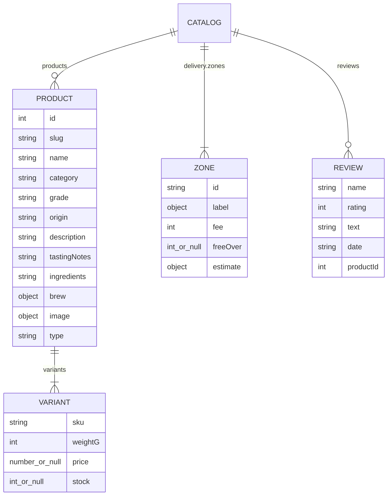

# DATABASE — Cha Bazaar Data Structures

> Status legend: **IMPLEMENTED** · **PROPOSED** · **TBD** (see [PRD.md](PRD.md)).
> Related: [ARCHITECTURE.md](ARCHITECTURE.md) · [API.md](API.md) · [AUTH_SECURITY.md](AUTH_SECURITY.md) · [apps-script/README.md](apps-script/README.md)

There is no database server. Data lives in three places:

| Where | What | Who can see it |
|---|---|---|
| `catalog.js` (in the repository) | Products, pack sizes, prices, stock, delivery zones, reviews | Public |
| Google Sheet "Cha Bazaar Orders" | Orders, order lines, website messages, promo codes | Owner only |
| Visitor's browser (`localStorage`) | Cart, delivery area, language, recent order IDs, opt-in saved details | That visitor only |

## 1. Catalogue: `catalog.js` (IMPLEMENTED)

`window.CHA_CATALOG =` followed by **strict JSON** and a final `;`. The Apps Script server parses the same file, so prices can't drift. `npm run check` validates it.

| Field | Notes |
|---|---|
| `products[].slug` | Used in `#tea/<slug>` links. Unique |
| `products[].type` | Omitted or `"tea"` for the main grid; `"bundle"` shows in Sampler boxes (none exist yet) |
| `products[].image` | `card` (600×450 WebP), `large` (≤1000px WebP), `fallback` (original JPEG), `alt` |
| `variants[].sku` | Unique, never renamed (carts and orders refer to it) |
| `variants[].price` | Taka; `null` hides the size (Chamomile 100g and 250g are `null` until priced) |
| `variants[].stock` | `null` not tracked; `0` sold out; `1…lowStockThreshold` "Only N left". Not reduced automatically |
| `delivery.zones` | `inside_dhaka` ৳60, free from ৳1,500, 1–2 days; `outside_dhaka` ৳120, never free, 3–5 days |
| `reviews` | **Genuine reviews only.** Empty today |

Current packs (prices, grades and origins are the owner's to confirm, PRD Q-6):

| SKU | Product | Pack | Price ৳ | ৳/100g |
|---|---|---|---|---|
| CB-DARJ-100 | Darjeeling First Flush | 100g | 650 | 650 |
| CB-ASSM-200 | Assam Breakfast Blend | 200g | 380 | 190 |
| CB-MSLA-200 | Masala Chai | 200g | 420 | 210 |
| CB-GRN-100 | Green Tea | 100g | 450 | 450 |
| CB-JSMN-100 | Jasmine Green Tea | 100g | 520 | 520 |
| CB-PREM-250 | Premium Estate Blend | 250g | 950 | 380 |
| CB-CHAM-050 | Chamomile Calm | 50g | 480 | 960 |
| CB-CHAM-100 / CB-CHAM-250 | Chamomile Calm | 100g / 250g | *not set (hidden)* | — |
| CB-MIXD-200 | Everyday Mixed Tea | 200g | 350 | 175 |

## 2. Google Sheet (IMPLEMENTED in `Code.gs`; created by `setup()`)

### `Orders`: one row per order

| # | Column | Example | Source |
|---|---|---|---|
| A | Order ID | `CB-261107-0042` | Server: Dhaka date + running number (`ORDER_SEQ` script property) |
| B | Order date | `2026-11-07 20:28:41` | Server clock, Asia/Dhaka |
| C | Status | `New` | Owner edits: Confirmed, Dispatched, Delivered, Cancelled |
| D | Customer name | | Validated |
| E | Phone | `01712345678` | Normalised |
| F | Email | | Optional |
| G | Delivery address | | |
| H | Delivery area | `Inside Dhaka` | From catalogue zone |
| I | Delivery estimate | `1–2 days` | From catalogue zone |
| J | Products | `2 × Assam Breakfast Blend 200g @ ৳380 = ৳760` (one line per product) | Server-priced |
| K | Total quantity | `3` | |
| L | Subtotal (BDT) | `1180` | Server |
| M | Discount (BDT) | `0` | Server, from Promos |
| N | Promo code | | |
| O | Delivery charge (BDT) | `60` | Server |
| P | Total (BDT) | `1240` | Server |
| Q | Payment method | `Cash on delivery` / `bKash (manual)` / `Nagad (manual)` | |
| R | Customer note | | |
| S | Language | `en` / `bn` | |
| T | Request ID | | For de-duplication and debugging |

### `Order Items`: one row per product line

Order ID · Order date · SKU · Product · Pack size (g) · Quantity · Unit price (BDT) · Line total (BDT)

### `Messages`

Received · Status · Name · Email or phone · Message · Language

### `Promos` (owner-managed; empty by default)

Code · Type (`percent` or `fixed`) · Value · Minimum subtotal · Maximum discount · Active (TRUE/FALSE) · Starts · Ends · Note

Customer text beginning with `= + - @` is stored with a leading `'` so it can't run as a formula.

### Script properties

| Key | Purpose |
|---|---|
| `CATALOG_URL` | Live `catalog.js` address (required) |
| `OWNER_EMAIL` | E-mail alerts (optional) |
| `ORDER_SEQ` | Running order number (managed by the script) |

## 3. Browser storage (IMPLEMENTED)

| Key | Format | Personal data? |
|---|---|---|
| `tea-shop-cart` | `[{ "sku": "CB-ASSM-200", "qty": 2 }]`. Old `{id, qty}` rows are migrated to the default pack size; unknown, unpriced or sold-out SKUs are ignored | No |
| `tea-shop-area` | `"inside_dhaka"` | No |
| `tea-shop-orders` | Last 10 **server-confirmed** orders: `[{ id, createdAt, total, items: [{ sku, qty }] }]`. Older entries containing customer details are stripped and marked `local` (never sent) | No |
| `tea-shop-customer` | `{ name, phone, email, address, area }`, **only** when "Save my details on this device" is ticked; removed by "Forget my saved details" | **Yes (opt-in)** |
| `cha-lang` | `"en"` or `"bn"` | No |
| `cha-motion-paused` | `"1"` or `"0"` | No |
| `cha-analytics-consent` | `"granted"` or `"denied"` (GA4 only) | No |
| `sessionStorage["cha-setup-dismissed"]` | Development setup bar hidden | No |

## 4. Retention and privacy

| Data | Retention |
|---|---|
| Sheet orders and messages | Owner policy (TBD); privacy policy says "as long as needed for delivery, returns and accounts" |
| Browser data | Until the visitor clears it |
| Apps Script cache (de-duplication, rate limits, catalogue) | Up to 6 hours |

## 5. Proposed

| Change | Feature |
|---|---|
| Live stock in a Sheet `Products` tab, decremented on order | PROPOSED (P-15 follow-up) |
| Bangla product descriptions (`description_bn` etc.) | PROPOSED |
| Relational database, if the shop moves to its own server | PROPOSED, Phase 4 (needs approval) |
