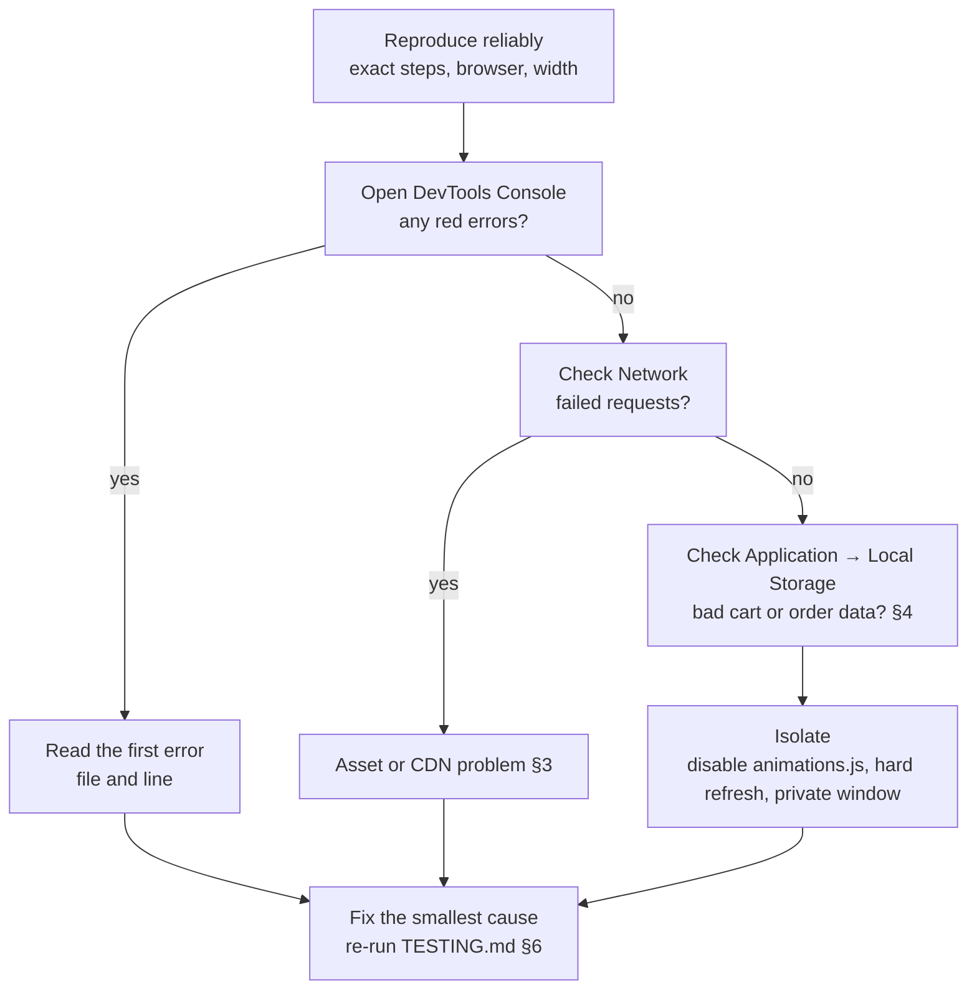

# DEBUGGING — Cha Bazaar Troubleshooting Guide

> Related: [ARCHITECTURE.md](ARCHITECTURE.md) · [TESTING.md](TESTING.md) · [SETUP.md](SETUP.md) · [API.md](API.md)
>
> The stack is static HTML, CSS and vanilla JS with Bootstrap 5.3.3 from a CDN and data in `localStorage`. There is no server log to look at; almost everything is visible in the browser's DevTools.

## 1. The method



1. **Reproduce.** Write down the exact steps, browser and screen width.
2. **Look before changing.** Check the Console, Network and Local Storage.
3. **Isolate.**
   - Try a private window (clean storage, no extensions).
   - Do a hard refresh (`Ctrl + Shift + R`, or `Cmd + Shift + R` on Mac).
   - Temporarily comment out `<script src="animations.js">` to rule out the motion layer.
4. **Fix the cause**, not the symptom.
5. **Re-test** the protected functionality (AGENTS.md §2).

## 2. Tools

| Tool | Where | Use |
|---|---|---|
| Console | F12 → Console | Errors; run app functions directly, e.g. `readCart()`, `cartSubtotal()`, `deliveryFee(1400)` |
| Elements | F12 → Elements | Inspect classes such as `.was-validated`, `.motion`, `.card-wait`/`.card-enter`, `aria-pressed` |
| Network | F12 → Network (tick *Disable cache*) | 404s on images; blocked CDN files |
| Application | F12 → Application → Local Storage | View or edit `tea-shop-cart` and `tea-shop-orders` |
| Rendering | F12 → ⋮ → More tools → Rendering | Emulate `prefers-reduced-motion: reduce` |
| Device toolbar | `Ctrl + Shift + M` | Test 390px and other widths |
| Lighthouse | F12 → Lighthouse | Performance and accessibility audits |

Useful console snippets:

```js
// Current cart, with product fields joined
readCart()

// Reset everything
localStorage.removeItem("tea-shop-cart"); localStorage.removeItem("tea-shop-orders"); location.reload()

// Elements wider than the screen (horizontal scroll hunt)
[...document.querySelectorAll("body *")].filter(e => e.getBoundingClientRect().right > innerWidth + 1)
```

## 3. Common problems

| Symptom | Likely cause | Fix |
|---|---|---|
| Blank product grid; console shows `bootstrap is not defined` | The jsDelivr CDN is blocked or offline; `app.js` stops at `bootstrap.Toast…` | Check Network for failed `cdn.jsdelivr.net` requests; check the internet connection or firewall. A long-term option is a local Bootstrap copy (TBD) |
| Headings in plain Arial or Impact | Google Fonts blocked | Network tab: `fonts.googleapis.com` / `fonts.gstatic.com`; the fallback fonts are expected while offline |
| Icons are empty squares | Bootstrap Icons font blocked | Same as above, for `bootstrap-icons` |
| An image works locally but is broken on GitHub Pages | **Case-sensitive file names** (this happened with `Assam_tea.jpg` vs `Assam_Tea.jpg`) | Match the exact case in `products[].image` |
| Every card shows the mixed-tea photo | The image failed, so `FALLBACK_IMAGE` was used | Network tab → find the 404; fix the path or URL |
| Premium Estate Blend photo missing | The Unsplash hotlink is blocked or changed | Host it locally (P-10, P-14) |
| Cart shows items that "shouldn't be there" | Old data in `localStorage` from testing | Delete `tea-shop-cart`. Unknown IDs are already ignored |
| Cart doesn't update in another tab | The `storage` event only fires in *other* tabs of the same origin; `file://` pages may not share storage | Use a local server (SETUP.md §3) |
| Changes don't appear | Browser cache (GitHub Pages caches for about 10 minutes) | Hard refresh; on Pages, wait or add `?v=2` to the asset URLs (TBD) |
| Checkout button does nothing | The cart is empty (the button is disabled) | Add an item |
| "Place order" never succeeds | A field is invalid, e.g. the phone doesn't match `(\+?88)?01[3-9]\d{8}` | Look for red field messages; in the console, `document.querySelector("#checkoutForm :invalid")` |
| Section heading never appears | A clip-path wipe on an element observed directly: fully clipped elements never count as visible | Observe the **parent**, which `animations.js` already does via `revealTargets`. Keep this pattern for new clipped reveals |
| Cards stay invisible | The `.card-wait` class wasn't replaced; the IntersectionObserver never fired | Check that the grid columns still have the `col-12` class that `prepareCards()` selects |
| Page scrolls sideways on phones | Bootstrap `g-5` gutters wider than the container padding, or a new wide element | Use `g-4 g-lg-5`; run the overflow snippet (§2) |
| Animations run despite "Reduce motion" | New motion added outside `@media (prefers-reduced-motion: no-preference)` or before the early `return` in `animations.js` | Move it inside the guard |
| Phone shown with spaces in the order | — | Not a bug: spaces and dashes are stripped as the user types |

## 4. Data problems

`localStorage` is per browser and per origin. `http://localhost:8000`, `file://` and the live site each have their own separate data.

| Check | How |
|---|---|
| Cart format | It must be `[{ "id": number, "qty": positive integer }]` (DATABASE.md §3) |
| Orders | `JSON.parse(localStorage["tea-shop-orders"])`, an array of order objects |
| Storage blocked (Safari private mode or strict settings) | `readJSON` and `writeJSON` fail silently, so the cart won't persist; expected behaviour |

## 5. Debugging the proposed order endpoint (P-01)

| Symptom | Check |
|---|---|
| CORS error in the console | The request must use `Content-Type: text/plain`; a JSON content type triggers a preflight that Apps Script can't answer (API.md §1) |
| `ok:false` responses | Read the `error` code (API.md §1.5 table) |
| Nothing in the Sheet | Apps Script editor → **Executions** to see logs and stack traces |
| Works for you but not for customers | The deployment access isn't set to *Anyone*, or an old deployment URL is in `ORDER_ENDPOINT` |
| Duplicate rows | Check the `clientRequestId` handling and that the button is disabled while sending |

Use the **test** deployment and test Sheet while debugging (MCP.md §3).

## 6. Collecting a good bug report

1. The steps, expected result and actual result
2. Browser and version, operating system, and screen width
3. A screenshot of the console showing the first red error
4. `localStorage["tea-shop-cart"]` (and orders, **with personal data removed**)
5. The commit you are on (`git log -1 --oneline`)

Then follow TESTING.md §8.


## 7. v2 additions: orders, settings and translations

| Symptom | Likely cause | Fix |
|---|---|---|
| Checkout says "Online ordering isn't switched on yet" | `ORDER_ENDPOINT` is still `YOUR_APPS_SCRIPT_URL` | Deploy the server and set it (apps-script/README.md) |
| "We couldn't confirm your order" every time | Wrong `/exec` URL, deployment access not **Anyone**, or offline | Open the URL in a browser: it must show `{"ok":true,...}` |
| Console shows a CORS error on `/exec` | Request sent with a JSON content type, or a `/dev` URL | Keep `Content-Type: text/plain` (as in `postToServer`) and use the `/exec` URL |
| "Prices or delivery charges have changed" on every order | Server reads a different `catalog.js` (wrong `CATALOG_URL`, or not yet published) | Fix `CATALOG_URL`; run `checkSetup` in Apps Script to clear the cache |
| Whole shop blank after editing `catalog.js` | JSON syntax error (trailing comma, single quotes, comment inside braces) | `npm run check` shows the exact problem |
| A pack size doesn't appear | Its `price` is `null` | Set a price |
| WhatsApp button, phone or Facebook links missing | That setting is still `YOUR_…` | Fill it in `config.js` (the yellow setup bar on localhost lists them) |
| Bangla shows boxes or English | Font blocked, or a new `data-i18n` key without Bangla | Check Google Fonts in Network; `npm run check` lists missing keys |
| Quick view doesn't open from a link | Slug isn't in `catalog.js` (you'll see "We couldn't find that tea") | Check `products[].slug` |
| Order rows have `'` in front of some text | Customer text started with `= + - @` (formula protection) | Expected |
| Order numbers jumped | Test orders were deleted; the sequence keeps counting | Delete the `ORDER_SEQ` script property to restart (only before launch) |

Server-side logs: Apps Script editor → **Executions**. To run the real server code locally, use `npm run serve` (see SETUP.md §8).
