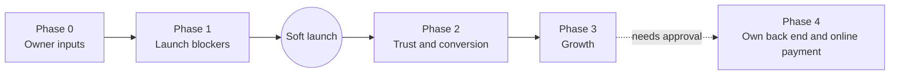

# PLAN — Cha Bazaar Implementation Roadmap

> Status legend: **IMPLEMENTED** · **PROPOSED** · **TBD** (see [PRD.md](PRD.md)).
> Related: [PRD.md](PRD.md) §9 (audit) · [FEATURES.md](FEATURES.md) (steps and acceptance criteria) · [AGENTS.md](AGENTS.md)
>
> Nothing in this plan has started. Each phase begins only after the owner confirms it.

## 1. Where we are

| Done (IMPLEMENTED) | Blocking launch |
|---|---|
| F-01 to F-12: catalogue, filters, cart, checkout UI, confirmation, contact UI, brand, motion, responsive layout | Orders don't reach the owner (A-01); no phone or WhatsApp (A-02); wrong delivery pricing outside Dhaka (A-03); vague payment labels (A-06); contrast failures (A-08); unverified image licences (A-14) |

## 2. Phase overview

## 3. Phase 0: owner inputs (prerequisite)

Phase 1 can't be finished without these. They come from PRD §11.

| # | Input | Unblocks |
|---|---|---|
| Q-1 | Order destination (recommended: Google Sheet + email alert, with WhatsApp as fallback) | P-01, P-13 |
| Q-2 | Phone and WhatsApp numbers | P-02 |
| Q-3 | Contact email, address, opening hours | P-02 |
| Q-4 | Delivery fees and times inside and outside Dhaka | P-03 |
| Q-6 | Confirmed prices, pack sizes, grades and origins | Launch content |
| Q-7 | Which mobile-banking services are accepted, and the numbers | P-06 |
| Q-8 | Image licences or replacement photos | P-14 |
| — | A Google account that will own the Sheet and Apps Script | P-01 |

## 4. Phase 1: launch blockers

Order matters: P-01 first because it carries the most risk.

| Order | ID | Item | Audit | Size | Depends on |
|---|---|---|---|---|---|
| 1 | **P-01** | Send orders to the Google Sheet through Apps Script; server-side totals; loading and error states; WhatsApp fallback; stop storing full personal data locally | A-01 | L | Q-1, P-02 (for the fallback) |
| 2 | **P-02** | Phone (`tel:`) link, floating WhatsApp button, Facebook link; real contact details | A-02 | S | Q-2, Q-3 |
| 3 | **P-03** | Delivery zone selector (Inside / Outside Dhaka) with fees and delivery estimates; replaces the flat ৳60 | A-03 | M | Q-4 |
| 4 | **P-06** | Payment options become Cash / bKash / Nagad (all on delivery) | A-06 | S | Q-7 |
| 5 | **P-08** | Darken amber to pass 4.5:1 | A-08 | S | — |
| 6 | **P-13** | Send contact-form messages to the Sheet | A-13 | S | P-01 endpoint |
| 7 | **P-14** | Confirm image licences or replace the photos | A-14 | S | Q-8 |

**Exit criteria (soft launch):**
- The product acceptance criteria in PRD §8 are met.
- A real test order made from a phone appears in the Sheet within a minute.
- An email alert arrives for that order.

## 5. Phase 2: trust and conversion (first week after launch)

| ID | Item | Audit | Size |
|---|---|---|---|
| P-04 | Testimonials (real ones only), freshness guarantee, Delivery, Returns and Privacy pages or sections | A-04 | M |
| P-05 | Price per 100g; multiple pack sizes (`variants`) | A-05 | M–L (changes the cart format; needs a migration) |
| P-09 | Pause control for the ticker and leaves | A-09 | S |
| P-10 | WebP images at about 600px, with `width`/`height` set | A-10 | S |
| P-11 | Remove the add-to-cart toast | A-11 | XS |
| P-12 | Open Graph tags, `Product` structured data, canonical URL, social image | A-12 | S |
| P-24 | Subresource Integrity hashes and a Content-Security-Policy | AUTH_SECURITY.md | S |
| P-23 | Automated E2E smoke tests with Playwright (dev-only tooling; **needs approval** because it adds `package.json`) | TESTING.md | M |

## 6. Phase 3: growth

| ID | Item | Audit | Size |
|---|---|---|---|
| P-07 | Quick-view panel and `#tea/<slug>` share links | A-07 | M |
| P-15 | Stock badges, read from the Sheet `Products` tab | A-15 | M |
| P-16 | Sampler bundle | A-16 | S |
| P-17 | Promo codes, validated server-side | A-17 | M |
| P-18 | Remember details (opt-in) | A-18 | S |
| P-19 | Privacy-friendly analytics | A-19 | S (needs owner choice) |
| P-20 | Bangla language toggle | A-20 | L |
| P-21 | "Reorder" from the confirmation | A-21 | S |

## 7. Phase 4: optional, needs explicit approval

| ID | Item | Why it needs approval |
|---|---|---|
| P-22 | Own API server and database (DATABASE.md §3.3); online bKash/Nagad payment | Changes the stack; costs money; handles payments and credentials |

## 8. Risks

| Risk | Impact | Mitigation |
|---|---|---|
| Apps Script quota or outage | Orders lost | WhatsApp fallback; the cart is kept when sending fails; email alert per order |
| Spam orders to a public endpoint | Fake orders | Honeypot, server-side validation, rate limit, owner calls to confirm (AUTH_SECURITY.md §5) |
| Price list duplicated in `app.js` and Apps Script | Wrong totals | One server-side `Products` tab as the source; P-01 adds a check that the totals match |
| Cart format change in P-05 | Existing carts break | Migrate or drop invalid rows (`readCart()` already does) |
| CDN blocked | Site broken | P-24 plus an optional local Bootstrap copy (TBD) |

## 9. Tracking

Feature statuses live in FEATURES.md. When an item ships, update its status to IMPLEMENTED in FEATURES.md, PRD.md §4 and this plan in the same commit (AGENTS.md §3, step 7).
