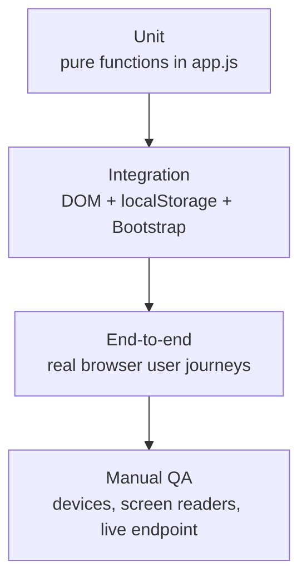

# TESTING — Cha Bazaar Test Plan

> Status legend: **IMPLEMENTED** · **PROPOSED** · **TBD** (see [PRD.md](PRD.md)).
> Related: [FEATURES.md](FEATURES.md) · [AGENTS.md](AGENTS.md) · [DEBUGGING.md](DEBUGGING.md) · [SETUP.md](SETUP.md)

## 1. Current state

| Item | Status |
|---|---|
| Automated tests in the repo | **None** |
| Test runner or `package.json` | None |
| CI | None |
| Ad-hoc checks during development | A headless-Chromium script (not committed) exercised: catalogue render, filtering, add/decrease, totals (৳1,470 / ৳820), validation, order placement, the empty cart afterwards, no horizontal scroll at 390px and 1280px, reduced motion, no console errors. All passed on commit `1b25d2e` |

**PROPOSED (P-23, needs approval):** a dev-only `package.json` with Playwright, plus the tests in §3–§5. Until then, run §6 manually before every merge.

## 2. Strategy



Because `app.js` is a classic script, its top-level functions are globals. Unit tests can call them inside the page through Playwright `page.evaluate()` **without changing the source code**.

## 3. Unit tests (PROPOSED)

| ID | Function | Case | Expected |
|---|---|---|---|
| U-01 | `formatPrice` | `1470` | `"৳1,470"` |
| U-02 | `formatPrice` | `0` | `"৳0"` |
| U-03 | `escapeHtml` | `"'&` | `&lt;img onerror=x&gt;&quot;&#39;&amp;` |
| U-04 | `deliveryFee` | `0` / `1` / `1499` / `1500` / `5000` | `0` / `60` / `60` / `0` / `0` |
| U-05 | `readCart` | storage `[{id:1,qty:2},{id:99,qty:1},{id:2,qty:0},{id:3,qty:1.5}]` | Only `{id:1, qty:2}` survives, with product fields joined |
| U-06 | `readCart` | storage `"not json"` | `[]` |
| U-07 | `cartCount` / `cartSubtotal` | ids 1×1, 3×2 | `3` / `1490` |
| U-08 | `setQty` | qty 1 → 0 | Line removed |
| U-09 | `generateOrderId` | 100 calls | All match `^CB-[0-9A-Z]+$` and are unique |
| U-10 | `applyFilters` | search "ctc" | 2 cards (Masala Chai, Everyday Mixed Tea) |
| U-11 | `applyFilters` | category Green + sort price-desc | Jasmine (520) before Green Tea (450) |

Sketch (PROPOSED, not committed):

```js
test("deliveryFee thresholds", async ({ page }) => {
  await page.goto("/");
  const r = await page.evaluate(() => [0, 1, 1499, 1500].map(deliveryFee));
  expect(r).toEqual([0, 60, 60, 0]);
});
```

## 4. Integration tests (PROPOSED)

| ID | Area | Steps | Expected |
|---|---|---|---|
| I-01 | Cart ↔ storage | Add 2 teas, reload | Same cart and count after reload |
| I-02 | Cross-tab sync | Two pages in one context; add in A | B's count updates |
| I-03 | Bootstrap wiring | Click Checkout | The offcanvas closes and the modal opens |
| I-04 | Image fallback | Route the Unsplash image to 404 | The card shows `Tea/MIX_tea.jpg` |
| I-05 | Animation independence | Block `animations.js` | The whole shop still works (§5 E-01 to E-06) |
| I-06 | Reduced motion | `reducedMotion: "reduce"` | No `.motion` class, no `.leaf`, all cards opacity 1 |
| I-07 | **Order endpoint** (P-01) | POST a valid order to the **test** deployment | `ok:true`; one row in the test Sheet; server total = sum of server prices |
| I-08 | **Price tampering** (P-01) | Send an order with fake `price` fields | Ignored; correct total |
| I-09 | **Validation** (P-01) | Bad phone; empty items; filled honeypot | `invalid_phone`; `invalid_items`; silently rejected |
| I-10 | **Duplicate** (P-01) | Same `clientRequestId` twice | One row |
| I-11 | **Contact** (P-13) | POST a valid message | Row in `Messages` |

## 5. End-to-end tests (PROPOSED)

Viewports: 390×844 (phone) and 1280×800 (desktop). CDN files may need to be served locally in sandboxed CI (DEBUGGING.md §3).

| ID | Journey | Expected |
|---|---|---|
| E-01 | Load the home page | 8 cards; no console errors; no horizontal scroll |
| E-02 | Search "assam", then clear; tab "Green"; sort price low-to-high | Correct cards and order each time; empty state appears for "zzz" and **Show all teas** resets it |
| E-03 | Add Darjeeling, Assam, Assam; open the cart | Count 3; subtotal ৳1,410; delivery ৳60; total ৳1,470; "Add ৳90 more…" |
| E-04 | Press − on Darjeeling | Line removed; count 2; total ৳820 |
| E-05 | Checkout → submit empty | Invalid fields marked; focus moves to Full name |
| E-06 | Fill in valid details with phone "017 1234-5678" → Place order | Confirmation with an ID like `CB-…`; count 0; `tea-shop-orders` has 1 entry |
| E-07 | Empty cart | Checkout and Empty cart disabled; **Browse the teas** closes the panel |
| E-08 | Contact form, invalid then valid | Messages shown, then a toast and a cleared form |
| E-09 | Keyboard only: Tab from the skip link through a card's Add to cart, open the cart, check out | Everything reachable; visible focus; Esc closes the modal and panel |
| E-10 | (After P-01) offline mode during Place order | Error and WhatsApp link; cart kept |

## 6. Manual QA checklist (use before every merge, even before P-23)

**Functional**
- [ ] Every item in AGENTS.md §2 "Protected functionality"
- [ ] Prices, grades and origins match the owner's confirmed list (PRD Q-6)

**Visual and responsive**
- [ ] 320, 390, 768, 1024 and 1440px wide: no overlap, no horizontal scroll
- [ ] Hero chest readable on a phone; tabs scroll on a phone
- [ ] Fonts load (stencil headings, not Arial)

**Browsers** (real devices where possible)
- [ ] Chrome and Edge on Windows
- [ ] Safari on macOS
- [ ] Firefox
- [ ] Android Chrome
- [ ] iOS Safari

**Accessibility**
- [ ] Keyboard-only run (E-09)
- [ ] Screen reader smoke test: NVDA on Windows, VoiceOver on iOS. The headline is read in full; tabs announce pressed state; the cart count changes
- [ ] Reduced motion on in the operating system: nothing animates
- [ ] Contrast check on any new colours (target 4.5:1). Known failures until P-08: amber pairs

**Performance**
- [ ] Lighthouse mobile: record Performance, Accessibility, Best Practices and SEO scores (targets TBD)
- [ ] Total transferred size on first load (target after P-10: < 1 MB)

**Live order flow (after P-01)**
- [ ] A real order from a phone on mobile data reaches the Sheet and the email alert
- [ ] Delete the test rows afterwards

## 7. Test data

| Data | Value |
|---|---|
| Valid phone numbers | `01712345678`, `+8801812345678`, `8801912345678` |
| Invalid phone numbers | `12345`, `01212345678` (operator digit 2), `0171234567` (10 digits) |
| Test address | `House 1, Road 1, Test Area` (never real customer data) |
| Reset | Delete `tea-shop-cart` and `tea-shop-orders` in DevTools (SETUP.md §5) |

## 8. Bug reports

Include:
- the steps to reproduce
- what you expected and what actually happened
- the browser, operating system and screen width
- console errors
- the `localStorage` contents
- a screenshot

See DEBUGGING.md for how to collect these.
