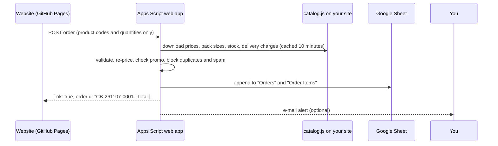

# Cha Bazaar order server: Google Sheets + Apps Script

The order server receives orders and website messages, re-checks every price on the server, and writes them to a Google Sheet that only you can see. It costs nothing and needs no hosting.



The website only shows "Order placed" after this server answers `ok: true`.

## What you need

- A Google account for the business. Turn on **2-Step Verification** for it.
- The website published at a public address (for example `https://sanjidmolik.github.io/Tea_shop/`), because the server downloads `catalog.js` from there.

## Step 1: create the Sheet and paste the code (about 10 minutes)

1. Go to https://sheets.google.com and create a blank spreadsheet. Name it **Cha Bazaar Orders**.
2. Open **Extensions → Apps Script**. A new tab opens with a file called `Code.gs`.
3. Delete everything in `Code.gs`. Paste the full contents of `apps-script/Code.gs` from this project, then press **Save** (the disk icon).
4. Click **Project Settings** (the gear icon on the left) and tick **Show "appsscript.json" manifest file in editor**.
5. Go back to **Editor** (the `< >` icon), open `appsscript.json`, replace its contents with `apps-script/appsscript.json` from this project, and save. This sets the Dhaka time zone and requests only three permissions:
   - this spreadsheet
   - downloading your catalogue
   - sending you an e-mail

## Step 2: settings

In **Project Settings → Script properties**, click **Add script property** and add:

| Property | Value |
|---|---|
| `CATALOG_URL` | Your live catalogue address, e.g. `https://sanjidmolik.github.io/Tea_shop/catalog.js` |
| `OWNER_EMAIL` | *(optional)* The e-mail address that should get an alert for every order and message |

Save the properties.

## Step 3: create the tabs and test

1. In the editor, choose the function **`setup`** in the toolbar drop-down and click **Run**.
   - Google asks you to authorise. Choose your account, click **Advanced**, then **Go to … (unsafe)**. This warning appears for every private script.
   - Allow the permissions.
2. Your Sheet now has the tabs **Orders**, **Order Items**, **Messages** and **Promos**, each with headers.
3. Choose **`checkSetup`** and click **Run**. The log should list every SKU with its price and the two delivery areas. If it says the catalogue could not be loaded, check `CATALOG_URL` and that the website is published.

## Step 4: deploy as a web app

1. Click **Deploy → New deployment**.
2. Click the gear next to "Select type" and choose **Web app**.
3. Fill in:
   - **Description:** `Cha Bazaar orders v1`
   - **Execute as:** `Me`
   - **Who has access:** `Anyone`
4. Click **Deploy** and copy the **Web app URL**. It ends in `/exec`.
5. Open the URL in your browser. You should see `{"ok":true,"service":"cha-bazaar-orders",...}`.

## Step 5: connect the website

In `config.js`, set:

```js
ORDER_ENDPOINT: "https://script.google.com/macros/s/XXXXXXXX/exec",
```

The URL is public on purpose; it isn't a password. All checks happen on the server. Commit, publish, then place a real test order from your phone. Check that:

- [ ] The confirmation shows an order ID like `CB-261107-0001`.
- [ ] A row appears in **Orders**, plus one row per product in **Order Items**.
- [ ] You receive the e-mail alert (if `OWNER_EMAIL` is set).

Delete your test rows afterwards. Order numbers keep counting up; to restart at 1, delete the script property `ORDER_SEQ`.

## Updating the code later

Paste the new `Code.gs`, then go to **Deploy → Manage deployments → ✏️ Edit**, set **Version: New version**, and click **Deploy**. Editing this way keeps the same URL. "New deployment" would create a new URL, which you would then have to copy into `config.js`.

## Managing orders

- **Status** column: change `New` to `Confirmed`, `Dispatched`, `Delivered` or `Cancelled` as you work. Add a dropdown with **Data → Data validation** if you like.
- **Products** shows each line as `qty × name size @ unit price = line total`. **Order Items** has one row per product for sums and pivot tables.
- Payment by bKash or Nagad is **manual**. Check the transfer in your bKash/Nagad app using the order ID reference before dispatch.

## Promo codes (optional)

There are no promo codes until you add rows to the **Promos** tab:

| Code | Type | Value | Minimum subtotal | Maximum discount | Active | Starts | Ends | Note |
|---|---|---|---|---|---|---|---|---|
| `EID10` | percent | 10 | 1000 | 200 | TRUE | 2026-03-01 | 2026-03-31 | Eid offer |
| `WELCOME50` | fixed | 50 | 500 | | TRUE | | | First order |

*(These rows are examples of the format only. Add only offers you actually want to run.)*

- Codes are case-insensitive, letters, digits, `-` and `_`.
- Discounts apply to the product subtotal before delivery.
- Free delivery is decided on the subtotal before discount.
- Set **Active** to `FALSE` to stop a code immediately.

## Stock

Stock lives in `catalog.js` (`"stock": null` means not tracked). Set a number to show "Only N left" and stop over-selling; set `0` for sold out. The server refuses orders for sold-out packs or more than the stock. It does **not** reduce the number automatically. Update `catalog.js` when your stock changes.

## Limits and safety

| Protection | Setting |
|---|---|
| Duplicate submission (double click, retry) | Same request ID returns the same order for 6 hours |
| Orders per phone number | 3 per 10 minutes |
| Messages per sender | 3 per 10 minutes |
| All requests | 120 per 10 minutes |
| Request size | 10,000 characters |
| Lines per order / quantity per line | 30 / 50 |
| Spam bots | Hidden "website" field must be empty |
| Formula injection | Text starting with `= + - @` is stored as plain text |

Change the numbers in `LIMITS` at the top of `Code.gs` if needed. Google also applies its own daily quotas to Apps Script (e-mails, run time, URL fetches); a small shop is well within them, but check the current quotas page if you run large campaigns.

## Troubleshooting

| Problem | Fix |
|---|---|
| Website says "Online ordering isn't switched on yet" | `ORDER_ENDPOINT` in `config.js` is still the placeholder |
| Website says it couldn't confirm the order | Open the `/exec` URL in a browser. If it doesn't show `ok: true`, check the deployment access is **Anyone** |
| `catalog_unavailable` in Executions | `CATALOG_URL` is wrong or the site is down. Run `checkSetup` |
| "Prices or delivery charges have changed" for every order | The website and server read different `catalog.js` files. Make sure `CATALOG_URL` points to the live site, then wait 10 minutes or run `checkSetup` (it clears the cache) |
| No e-mail | Check `OWNER_EMAIL` and **Executions** for warnings |
| See errors | Apps Script editor → **Executions** (left sidebar) |
